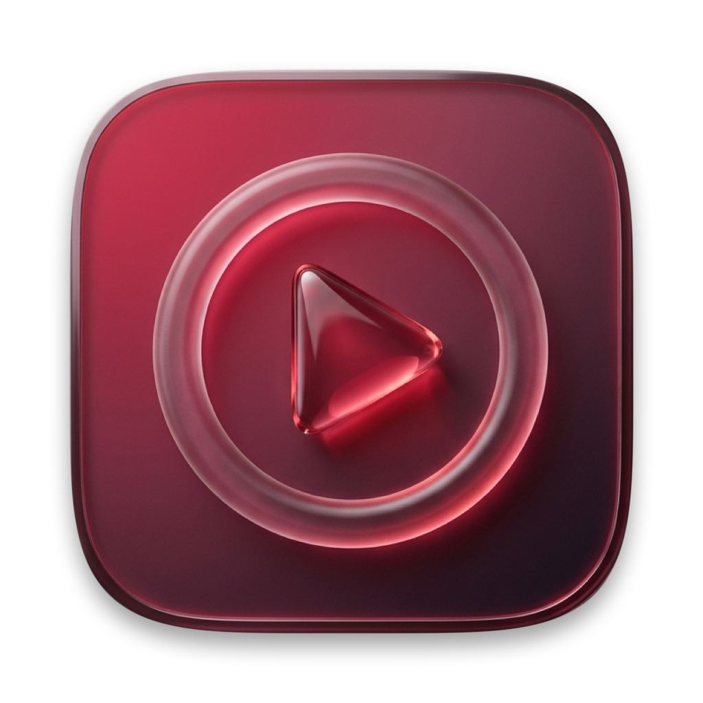
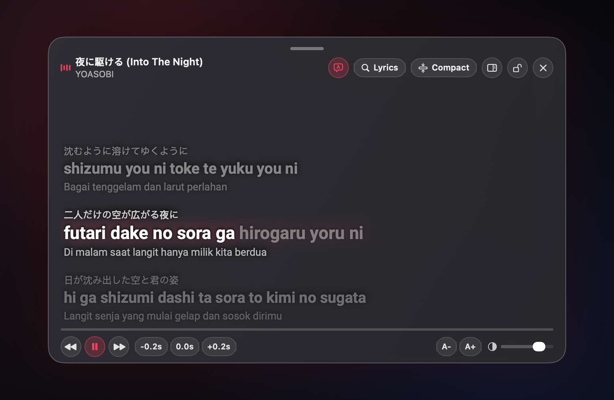
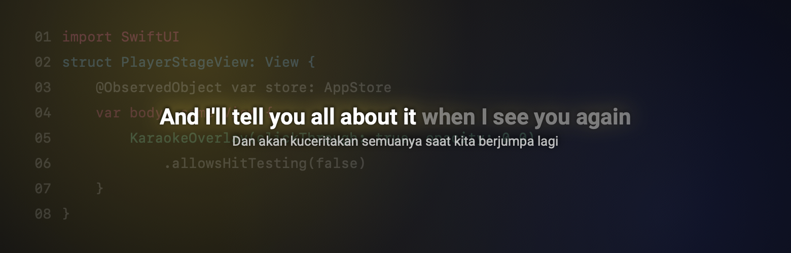
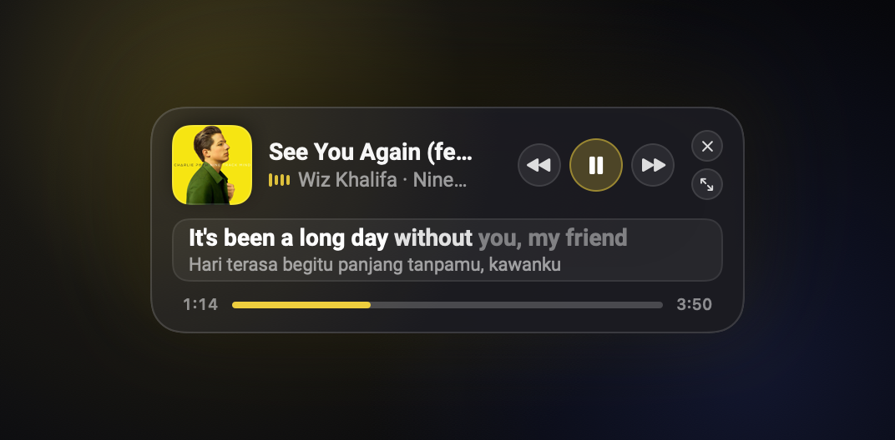
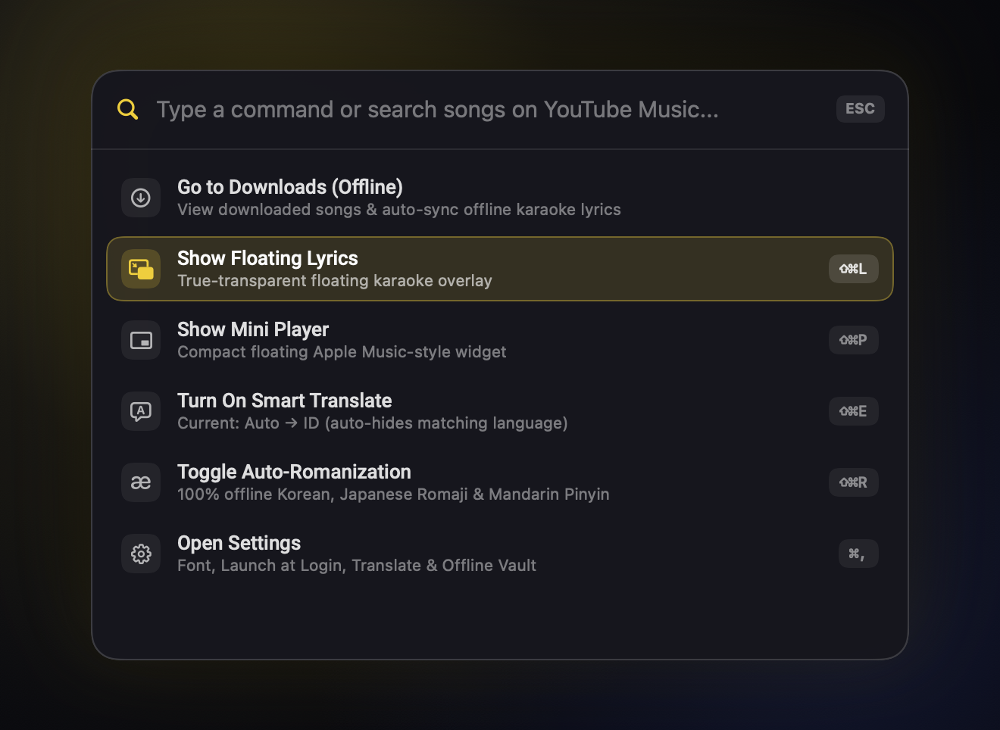
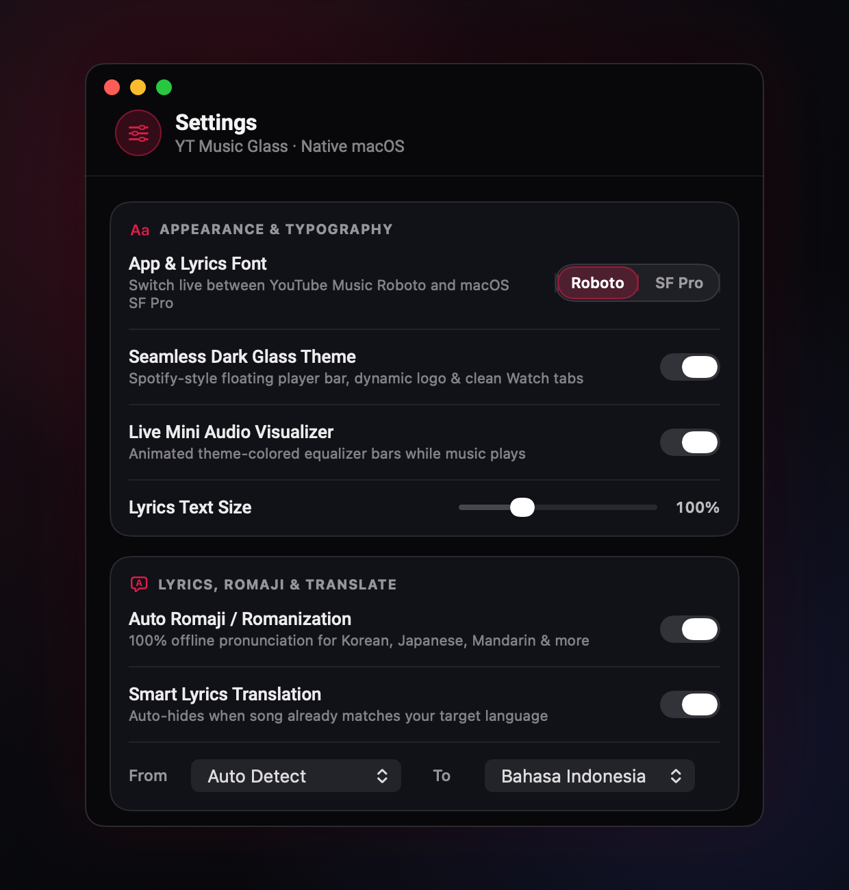
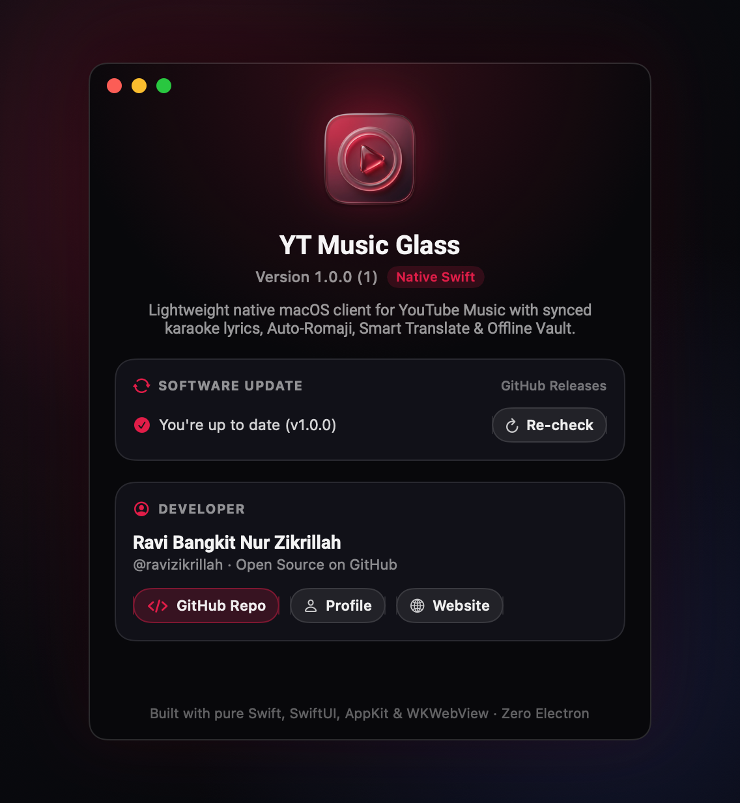

<div align="center">



# YT Music Glass

**A lightweight, pure Swift macOS desktop client for YouTube Music & YouTube.**  
Obsidian Liquid Glass interface · Spotify-style player bar · Synced karaoke lyrics · Offline Auto-Romaji · Smart Translate · Zero Electron.

<p>
  <a href="https://github.com/ravizikrillah/yt-music-glass/releases/latest">
    
  </a>
  
  
  
  <a href="https://yt-music-glass.vercel.app">
    
  </a>
</p>

**[Download Latest DMG](https://github.com/ravizikrillah/yt-music-glass/releases/latest)** · **[Website](https://yt-music-glass.vercel.app)** · **[Features](#features)** · **[Installation](#installation)** · **[Shortcuts](#keyboard-shortcuts)**

</div>

---

## Preview

<p align="center">
  
</p>

<p align="center">
  <sub><b>Main Window</b> — Dynamic album-art ambient theming, Spotify-style floating player bar, docked resizable Lyrics Sidebar with Floating Obsidian Glass controls, and Menu Bar Live Lyrics.</sub>
</p>

### Feature Gallery

<table>
  <tr>
    <td width="50%" align="center" valign="top">
      
      <br />
      <sub><b>Floating Lyrics HUD (<code>⇧⌘L</code>)</b> — Full karaoke card with 100% offline Auto-Romaji, Smart Translate, sync offset &amp; opacity slider.</sub>
    </td>
    <td width="50%" align="center" valign="top">
      
      <br />
      <sub><b>0% Transparent Click-Through (<code>⇧⌘K</code> / <code>⇧⌘M</code>)</b> — Pure floating karaoke text with crisp double shadow hovering over your editor or browser.</sub>
    </td>
  </tr>
  <tr>
    <td width="50%" align="center" valign="top">
      
      <br />
      <sub><b>Apple Music–Style Mini Player (<code>⇧⌘P</code>)</b> — Compact Obsidian Glass widget with album art, equalizer bars, live synced lyric strip &amp; seek bar.</sub>
    </td>
    <td width="50%" align="center" valign="top">
      
      <br />
      <sub><b>Quick Command Palette (<code>⌘K</code>)</b> — Raycast-style fuzzy launcher for actions, translation presets &amp; instant YouTube Music search.</sub>
    </td>
  </tr>
  <tr>
    <td width="50%" align="center" valign="top">
      
      <br />
      <sub><b>Native Settings (<code>⌘,</code>)</b> — Live <b>Roboto / SF Pro</b> typography switch, Dark Glass theme, Auto-Romaji, Smart Translate &amp; Offline Vault.</sub>
    </td>
    <td width="50%" align="center" valign="top">
      
      <br />
      <sub><b>About &amp; Auto-Updater</b> — Built-in GitHub Releases version checker and one-click macOS DMG updater.</sub>
    </td>
  </tr>
</table>

---

## Why YT Music Glass?

Most desktop wrappers for YouTube Music ship a full Chromium + Node.js runtime via Electron. **YT Music Glass** is compiled directly to a standalone native macOS app (`AppKit` + `SwiftUI` + `WKWebView`) with zero third-party frameworks.

| Capability | YT Music Glass (Pure Swift) | Typical Electron Wrappers |
| :--- | :--- | :--- |
| **Installer Size** | **~2.9 MB** `.dmg` | ~120 – 250 MB |
| **Runtime** | Native `AppKit` / `SwiftUI` + macOS `WKWebView` | Bundled Chromium + Node.js |
| **Synced Lyrics & Karaoke** | Built-in 60fps word-flow sync, Sidebar, Floating HUD, Mini Player & Menu Bar | Basic web lyrics tab or plugins |
| **Auto-Romaji & Translate** | 100% offline Romanization + Smart Language-Aware Translation | Not built-in |
| **Offline Karaoke Vault** | Auto-caches synced lyrics & translations for downloaded tracks | Requires active connection |
| **Updates** | Native GitHub Releases auto-updater (`Check for Updates…`) | Heavy auto-updater bundles |

---

## Features

### Interface & Player
- **Obsidian Liquid Glass UI:** Seamless native dark interface with dynamic ambient colors extracted from the currently playing album artwork.
- **Spotify-Style Floating Player Bar:** Centered Play/Pause control halo, crisp 60fps interactive progress bar, track info on the left, and clean utility controls on the right.
- **1-Click YouTube Music ↔ YouTube Switcher:** Instantly switch between `music.youtube.com` and `www.youtube.com` inside the same native window, with persistent Google Sign-In and Safari macOS OAuth support.
- **Live Typography Switcher:** Toggle between bundled **Roboto** and native macOS **SF Pro** across both the lyrics UI and the web interface in real time (`⌘,`).

### Multi-Surface Synced Lyrics
- **Docked Resizable Lyrics Sidebar (`⇧⌘S`):** Right-side glass drawer (`260pt–760pt`, double-click divider to reset) with word-flow karaoke sweep, animated `•••` instrumental break indicator, theme-colored mini audio visualizer, click-to-seek, sync offset (`-0.2s` / `+0.2s`), and LRCLIB candidate picker.
- **True Transparent Floating HUD (`⇧⌘L`):** Smooth opacity slider from `0%` (pure floating karaoke text with crisp double shadow) to `85%` native frosted glass, **Click-Through Lock (`⇧⌘K`)**, Compact / Full mode (`⇧⌘M`), and floats across all macOS Spaces and Fullscreen apps.
- **Apple Music–Style Mini Player (`⇧⌘P`):** Compact `356×136pt` floating Obsidian Glass widget with album art, transport controls, live 1-line karaoke strip (+ optional translation), and seek bar.
- **Menu Bar Live Lyrics (`⇧⌘B`):** Displays the active lyric line (with Auto-Romaji) directly in the macOS top Menu Bar and auto-collapses when paused.

### Auto-Romanization & Smart Translation
- **100% Offline Auto-Romanization (`⇧⌘R`):** Built-in pronunciation guide for **Korean** (Revised Romanization with phonological rules), **Japanese** (Kanji/Kana → Romaji via `CFStringTokenizer`), **Mandarin Pinyin**, Cyrillic, Thai, Arabic, Greek, and Devanagari — automatically skipping pure Latin lines.
- **Smart Lyrics Translation (`⇧⌘E`):** Toolbar **From → To** language picker (`Auto`, `EN`, `ID`, `JA`, `KO`, `ZH`, etc.) with persistent disk cache and automatic language-mismatch filtering (hides redundant translations when a song or line is already in your target language).

### Offline Karaoke Vault
- **Automatic Download Detection (`⇧⌘D` / `⇧⌘O`):** Detects YouTube Music **Downloads** (`/downloads`), downloaded albums/playlists, and Download clicks to pre-fetch and permanently pin synced lyrics + active translations to `~/Library/Application Support/YTMusicGlass/`.
- **3-Tier Offline Matching:** Resolves tracks offline via `trackKey` → `videoId` → normalized `artist + title`, paired with 100% offline Auto-Romanization.

### Native macOS Integrations
- **Quick Command Palette (`⌘K`):** Raycast/Spotlight-style fuzzy launcher to jump to Home, Downloads, or Library, search YouTube Music directly, change translation targets, or toggle any display mode from the keyboard.
- **Control Center, AirPods & Media Keys:** Native `MediaPlayer.framework` integration for macOS Now Playing, Lock Screen, headphone remote controls, and background playback when the main window is closed.
- **Native Settings (`⌘,`), Launch at Login & Auto-Updater:** Manage Launch at Login (`SMAppService`), font selection, Offline Vault, About window, and built-in GitHub Releases updates (`Check for Updates…`).

---

## Installation

### Option 1: Download DMG (Recommended)

1. Download **`YT-Music-Glass-macOS-arm64.dmg`** from [GitHub Releases](https://github.com/ravizikrillah/yt-music-glass/releases/latest) or [yt-music-glass.vercel.app](https://yt-music-glass.vercel.app).
2. Open the `.dmg` and drag **YT Music Glass** into **Applications**.
3. Launch **YT Music Glass** from Spotlight or Applications.

> [!NOTE]
> **First launch & macOS Gatekeeper:** Because the app is currently ad-hoc signed without an Apple Developer notarization certificate, macOS may show *"YT Music Glass is damaged"* or *"cannot be opened"*. Clear the quarantine attribute once in Terminal and reopen the app:
> ```bash
> xattr -cr "/Applications/YT Music Glass.app"
> ```

### Option 2: Build from Source

Requires **macOS 14+** and Apple Command Line Tools (`xcode-select --install`).

```bash
git clone https://github.com/ravizikrillah/yt-music-glass.git
cd yt-music-glass

make test     # Run Swift core unit tests
make build    # Compile dist-macos/YT Music Glass.app
make run      # Build and launch YT Music Glass.app
make install  # Build and install directly into /Applications/YT Music Glass.app
make dmg      # Build distributable DMG (dist-macos/YT-Music-Glass-macOS-arm64.dmg)
```

---

## Keyboard Shortcuts

| Shortcut | Action |
| :--- | :--- |
| <kbd>⌘</kbd> <kbd>K</kbd> | Open Quick Command Palette & instant song search |
| <kbd>⌘</kbd> <kbd>,</kbd> | Open native Settings window |
| <kbd>⇧</kbd> <kbd>⌘</kbd> <kbd>S</kbd> or <kbd>Shift</kbd> + <kbd>L</kbd> | Show / Hide docked right Lyrics Sidebar |
| <kbd>⇧</kbd> <kbd>⌘</kbd> <kbd>L</kbd> | Show / Hide transparent Floating Lyrics HUD |
| <kbd>⇧</kbd> <kbd>⌘</kbd> <kbd>P</kbd> | Show / Hide Apple Music–style Mini Player |
| <kbd>⇧</kbd> <kbd>⌘</kbd> <kbd>B</kbd> | Toggle Menu Bar Live Lyrics |
| <kbd>⇧</kbd> <kbd>⌘</kbd> <kbd>K</kbd> | Toggle Click-Through Lock (Floating HUD) |
| <kbd>⇧</kbd> <kbd>⌘</kbd> <kbd>M</kbd> | Toggle Compact / Full Mode (Floating HUD) |
| <kbd>⇧</kbd> <kbd>⌘</kbd> <kbd>E</kbd> | Toggle Smart Lyrics Translation |
| <kbd>⇧</kbd> <kbd>⌘</kbd> <kbd>R</kbd> | Toggle Auto-Romanization (Romaji / Korean / Pinyin) |
| <kbd>⇧</kbd> <kbd>⌘</kbd> <kbd>D</kbd> | Save current track lyrics to Offline Vault |
| <kbd>⇧</kbd> <kbd>⌘</kbd> <kbd>O</kbd> | Batch-download offline lyrics for current page (Downloads / Album / Playlist) |
| <kbd>⇧</kbd> <kbd>⌘</kbd> <kbd>T</kbd> | Toggle Obsidian Glass Theme vs. Original YouTube Music |
| <kbd>⌘</kbd> <kbd>R</kbd> | Reload current page |

---

## Auto-Update, Releases & Landing Page

- **Automated macOS Releases:** Pushing a semantic version tag triggers [`.github/workflows/release.yml`](.github/workflows/release.yml), which runs `make test`, compiles `YT-Music-Glass-macOS-arm64.dmg`, and publishes a GitHub Release automatically:
  ```bash
  git tag v1.0.1
  git push origin v1.0.1
  ```
  Both the in-app **Check for Updates…** updater and the landing page's download button automatically pull the newest `.dmg` from GitHub Releases.
- **Landing Page (`website/`):** Pure static, SEO-friendly website deployed to Vercel at **[yt-music-glass.vercel.app](https://yt-music-glass.vercel.app)** (Vercel Root Directory: `website`, Framework Preset: `Other`).

---

## Author

Built by **Ravi Bangkit Nur Zikrillah** ([@ravizikrillah](https://github.com/ravizikrillah)) · **[yt-music-glass.vercel.app](https://yt-music-glass.vercel.app)**

<sub>Disclaimer: YT Music Glass is an independent, unofficial desktop client and is not affiliated with, endorsed by, or connected to Google LLC or YouTube.</sub>
