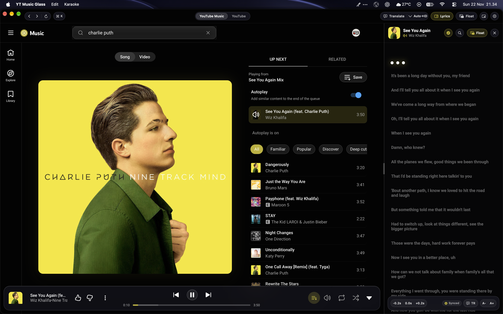

<div align="center">


# YT Music Glass

**A lightweight cross-platform desktop client for YouTube Music & YouTube.**  
Obsidian Liquid Glass interface · Synced 60fps karaoke lyrics · Auto-Romaji · Smart Translate · Offline Lyrics Vault · Zero Electron.

<p>
  <a href="https://github.com/ravizikrillah/yt-music-glass/releases/latest">
    
  </a>
  
  
  <a href="https://yt-music-glass.vercel.app">
    
  </a>
</p>

**[Download Latest Release](https://github.com/ravizikrillah/yt-music-glass/releases/latest)** · **[Website](https://yt-music-glass.vercel.app)** · **[Monorepo Architecture](#monorepo-architecture)** · **[Build & Install](#installation)**

</div>

---

## Monorepo Architecture

YT Music Glass uses a **Hybrid Multi-Engine** desktop architecture so every OS stays lightweight and native while sharing web styling, playback bridges, and core test contracts:

| Directory | Platform | Stack | Artifacts |
| :--- | :--- | :--- | :--- |
| [`apps/macos/`](apps/macos) | macOS 13.0+ (`arm64` & `x86_64`) | Pure Swift (`AppKit`, `SwiftUI`, `WKWebView`, `MediaPlayer`) | `YT-Music-Glass-macOS-arm64.dmg`, `YT-Music-Glass-macOS-x86_64.dmg` |
| [`apps/desktop/`](apps/desktop) | Windows 10/11 & Linux | Tauri v2 (`Rust` + `WebView2` / `WebKitGTK` + `whatlang`) | `.exe` (NSIS), `.zip` (Portable), `.AppImage`, `.deb` |
| [`packages/shared/`](packages/shared) | All desktop platforms | Shared CSS/JS web bridge (`web/`), Swift Core (`swift-core/`), AppIcon/Fonts (`resources/`), JSON vectors (`test-vectors/`) | Single source of truth |
| [`website/`](website) | Web Landing Page | Static HTML/CSS/JS with OS/arch auto-detect & All Desktop Platforms download matrix | Deployed to Vercel (`Root Directory: website`) |

---

## Preview

<p align="center">
  
</p>

---

## Platform Capabilities

### Shared Core Capabilities (macOS, Windows & Linux)
- **Obsidian Liquid Glass UI & Bridge (`packages/shared/web/`):** Unified CSS theme + JS playback/offline-discovery bridge (`emitToNative` supporting `WKWebView` and Tauri IPC).
- **Synced Word-Flow Lyrics & Tap-to-Sync:** LRCLIB search + Enhanced LRC word timing, click-to-seek, per-track sync offsets, and interactive Tap-to-Sync LRC recording.
- **Offline Karaoke Vault:** Resilient 3-tier offline matching (`trackKey` → `videoId` → normalized `artist + title`).
- **Auto-Romanization & Smart Translation:**
  - **macOS:** 100% offline Korean, Japanese Kanji/Kana (`CFStringTokenizer`), Mandarin Pinyin, and multi-script transliteration + `NLLanguageRecognizer`.
  - **Windows & Linux:** Embedded algorithmic Hangul/Kana/Cyrillic/Greek romanizer + `whatlang`/script language detection + **on-demand downloadable Kanji dictionary** cached locally for offline playback.
- **Uniform GitHub Releases Auto-Updater:** Checks `releases/latest` directly against GitHub Releases across every desktop OS.

### OS-Specific Enhancements
- **macOS (`arm64` & `x86_64`, macOS 13.0+):** `0%–85%` click-through `NSPanel` HUD across Spaces/Fullscreen, Menu Bar Live Lyrics, Apple Music-style Mini Player, `⌘K` Command Palette, `SMAppService` Launch at Login, and 1-click `.dmg` self-updater.
- **Windows & Linux (`Tauri v2`):** Click-through transparent Floating HUD, Mini Player, System Tray playback controls, and optional **Screen-Edge Mini Lyric Pill** (replacing macOS Menu Bar live lyrics).

---

## Installation

### Prebuilt Downloads
Download directly from [GitHub Releases](https://github.com/ravizikrillah/yt-music-glass/releases/latest) or via [yt-music-glass.vercel.app](https://yt-music-glass.vercel.app) (auto-detects your OS & CPU architecture):

- **macOS Apple Silicon (M1–M4):** `YT-Music-Glass-macOS-arm64.dmg`
- **macOS Intel:** `YT-Music-Glass-macOS-x86_64.dmg`
  > First-launch Gatekeeper note for unsigned macOS builds: `xattr -cr "/Applications/YT Music Glass.app"`
- **Windows:** `YT-Music-Glass-Windows-x64-Setup.exe` or `YT-Music-Glass-Windows-x64-Portable.zip`
- **Linux:** `YT-Music-Glass-Linux-x86_64.AppImage` or `YT-Music-Glass-Linux-amd64.deb`

### Build From Source

#### macOS (Apple Silicon & Intel, macOS 13.0+)
```bash
make test       # Verify shared web assets + run Swift core unit tests
make build-all  # Compile both arm64 and x86_64 .app bundles
make dmg-all    # Package both arm64.dmg and x86_64.dmg
```

#### Windows & Linux (`apps/desktop/`, requires Node 20+ & Rust/Cargo)
```bash
cd apps/desktop
npm install
cargo test --manifest-path src-tauri/Cargo.toml
npm run tauri build
```

---

## Author

Built by **Ravi Bangkit Nur Zikrillah** ([@ravizikrillah](https://github.com/ravizikrillah)) · **[yt-music-glass.vercel.app](https://yt-music-glass.vercel.app)**

<sub>Disclaimer: YT Music Glass is an independent, unofficial client and is not affiliated with, endorsed by, or connected to Google LLC or YouTube.</sub>
